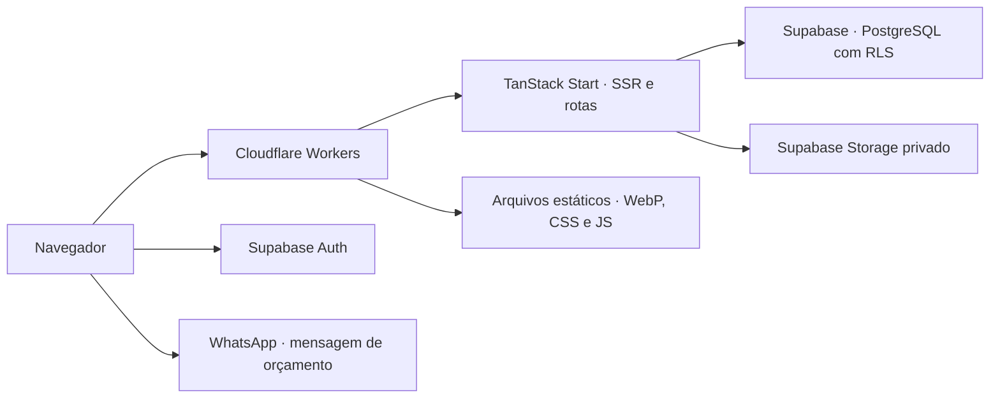

# NVX Web Solutions

Site institucional de uma agência digital. A demonstração reúne catálogo de serviços, portfólio interativo e solicitação de orçamento por WhatsApp. O projeto também inclui um painel administrativo para gerenciar conteúdo, projetos e solicitações.

[**Abrir a demonstração**](https://nvx-solutions.wbw.workers.dev/)

## Capturas da demonstração

| Portfólio | Orçamento |
| --- | --- |
|  |  |

Ver a página inicial em mobile

## Vídeos

| Gravação | O que mostra |
| --- | --- |
| [Tour em desktop · WebM](https://github.com/mvneves-dev/nvx-web-solutions-showcase/releases/download/demo-v1/tour-desktop.webm) | Página inicial, faixas animadas, filtros do portfólio e formulário de orçamento |
| [Tour em mobile · WebM](https://github.com/mvneves-dev/nvx-web-solutions-showcase/releases/download/demo-v1/tour-mobile.webm) | Adaptação a telas pequenas e o mesmo percurso em um viewport de 390 px |

## Funcionalidades

- Páginas de serviços, apresentação da agência, etapas do atendimento, contato, privacidade e termos.
- Portfólio com filtros, ampliação de imagens e projetos identificados como demonstrações conceituais.
- Formulário de orçamento com validação e seleção inicial do serviço ou pacote pelo link de origem.
- Painel protegido por autenticação e papel administrativo. Permite editar páginas, serviços, portfólio, depoimentos, FAQ, configurações de contato, formulários e SEO, além de acompanhar solicitações recebidas.
- Layout responsivo, imagens WebP, animações de entrada e rolagem suave com Lenis. O movimento considera as preferências de acessibilidade do visitante.

## Arquitetura

**Interface.** React, TypeScript, TanStack Router e Tailwind CSS. React Hook Form e Zod validam o formulário. TanStack Query apoia as operações de conteúdo.

**Servidor.** O TanStack Start renderiza as páginas na Cloudflare Workers. A rota raiz carrega o conteúdo público, e valores padrão preenchem configurações ausentes no CMS.

**Dados e mídia.** O Supabase fornece autenticação, PostgreSQL e armazenamento. As operações administrativas seguem as políticas RLS. Uma rota do servidor entrega imagens autorizadas dos buckets privados, incluindo imagens de projetos publicados.

**Orçamento.** O formulário abre uma mensagem pronta no WhatsApp e tenta salvar uma cópia da solicitação em segundo plano. O envio da mensagem depende da confirmação do visitante no WhatsApp.

## Como explorar a demonstração

1. Abra a [página inicial](https://nvx-solutions.wbw.workers.dev/) e role até as duas faixas animadas e a seção de serviços.
2. No [portfólio](https://nvx-solutions.wbw.workers.dev/portfolio), escolha uma categoria e abra um projeto para ver seus detalhes.
3. Em [Serviços](https://nvx-solutions.wbw.workers.dev/servicos), clique em **Solicitar orçamento** em um card e confira o serviço selecionado no formulário. Use o botão de envio somente para uma solicitação real.

> **Aviso sobre o código-fonte.** O código-fonte da NVX Web Solutions é privado e pode ser compartilhado mediante solicitação ao mantenedor do projeto.
